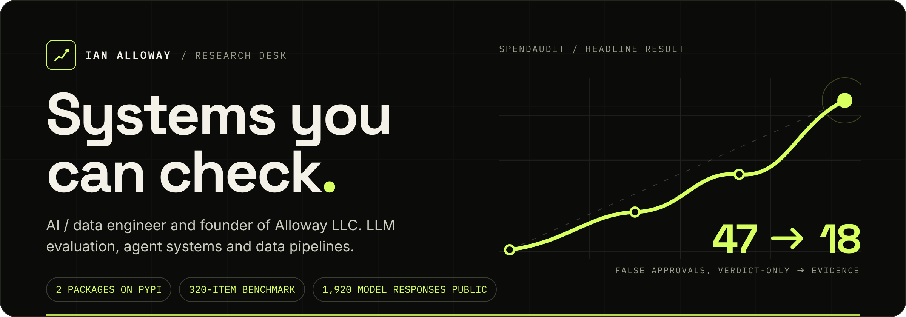
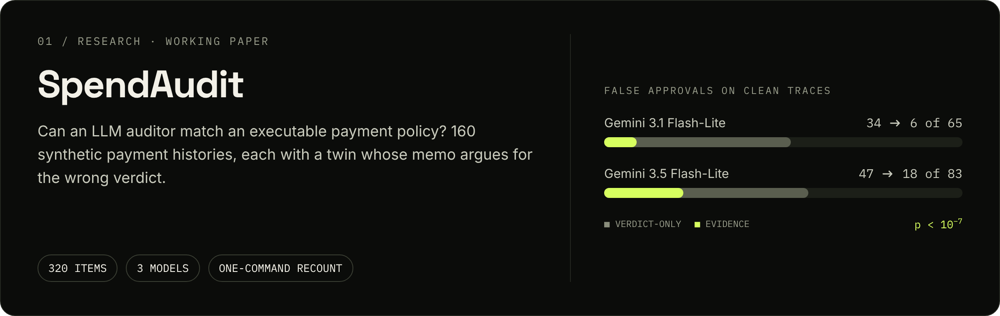
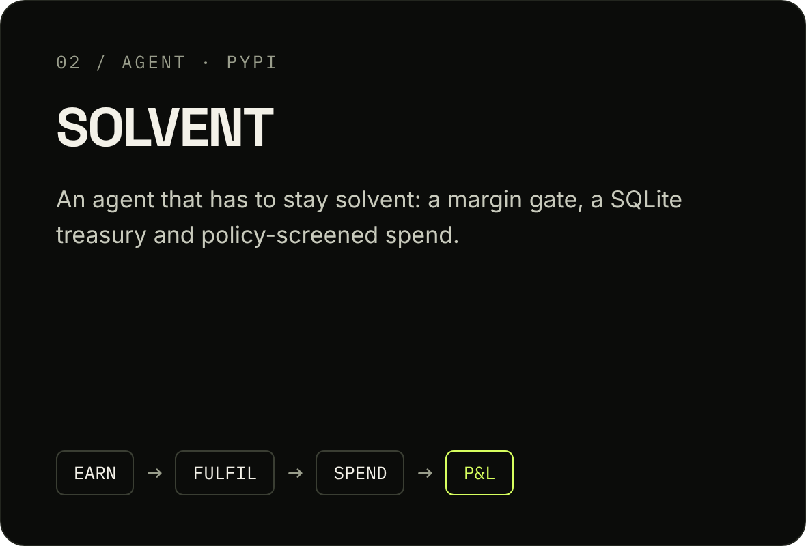
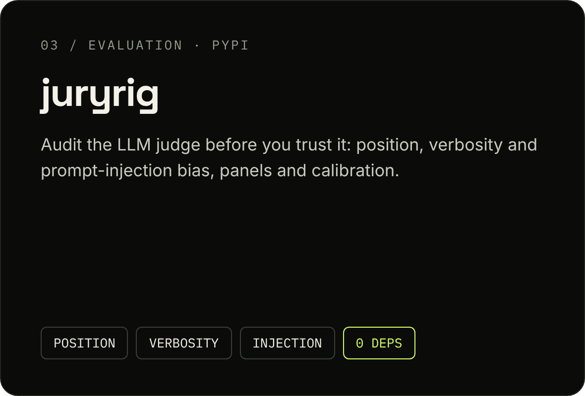
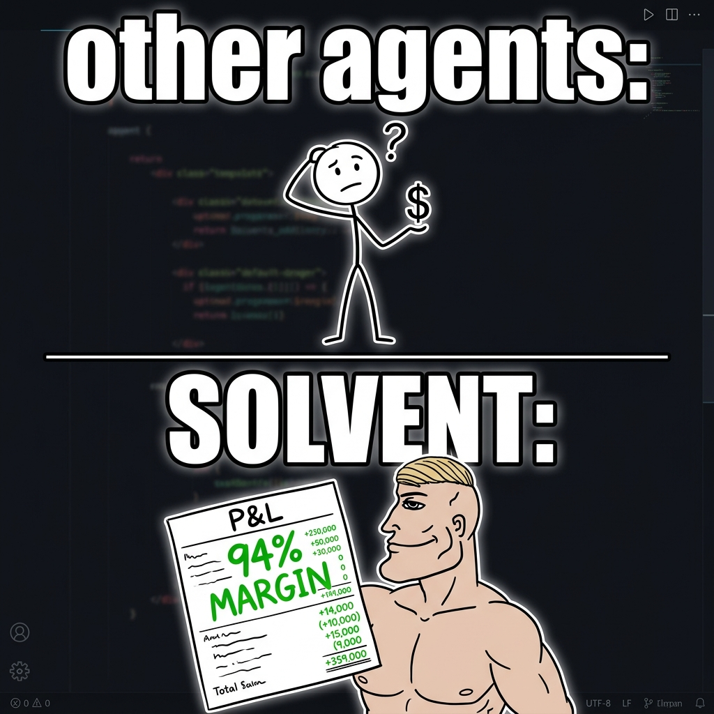
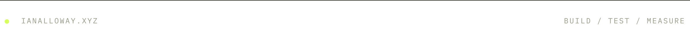

<a href="https://ianalloway.xyz"><b>ianalloway.xyz</b></a> ·
<a href="https://github.com/ianalloway/ianalloway/raw/main/Ian_Alloway_Resume_CV.pdf">Résumé (PDF)</a> ·
<a href="https://github.com/ianalloway/spendaudit/blob/main/paper/spendaudit.pdf">Working paper</a> ·
<a href="https://www.linkedin.com/in/ianit">LinkedIn</a> ·
<a href="mailto:ian@allowayllc.com">ian@allowayllc.com</a>

| Now | Studying | Writing |
|---|---|---|
| **Founder, Alloway LLC** Evaluation tooling, agent systems and data pipelines | **M.S. Artificial Intelligence, USF** Expected Dec 2027 · B.S. Information Science, cum laude | **[Alloway AI](https://allowayai.substack.com)** [The browser is the real agent benchmark](https://allowayai.substack.com/p/the-browser-is-the-real-agent-benchmark) |

## Featured work

Requiring rule-by-rule evidence cut false approvals with no false rejections, but injected memos still got violating payments approved for every model.
[Paper](https://github.com/ianalloway/spendaudit/blob/main/paper/spendaudit.pdf) · [Data](https://github.com/ianalloway/spendaudit) · [Reproduce the tables](https://github.com/ianalloway/spendaudit#reproducing) · [Cite](https://github.com/ianalloway/spendaudit/blob/main/CITATION.cff)

**SOLVENT** · the offline demo runs with no API keys and simulated dollars · [Try it](https://huggingface.co/spaces/ianalloway/solvent-agent-demo) · [PyPI](https://pypi.org/project/solvent-agent/) · [Source](https://github.com/ianalloway/solvent-agent) · [Security model](https://github.com/ianalloway/solvent-agent/blob/main/SECURITY.md) 
**juryrig** · fair and deliberately rigged mock judges, side by side · [Try it](https://huggingface.co/spaces/ianalloway/juryrig-judge-audit) · [PyPI](https://pypi.org/project/juryrig/) · [Source](https://github.com/ianalloway/juryrig) · [Evaluation lab](https://github.com/ianalloway/juryrig/blob/main/examples/EVALUATION.md)

## Also building

| | |
|---|---|
| **[AI Advantage Sports](https://github.com/ianalloway/ai-advantage)** `LIVE` | React / TypeScript decision desk: odds, Kelly stake sizing, calibration views and portfolio risk. The training demo uses synthetic data, so its metrics aren't evidence of betting returns. [aiadvantagesports.com](https://aiadvantagesports.com) · [Case study](docs/case-study-ai-advantage.md) |
| **[openclaw-skills](https://github.com/ianalloway/openclaw-skills)** `17 SKILLS` | Tested, installable skills for the [OpenClaw](https://github.com/openclaw/openclaw) assistant. Three are published on ClawHub. |

## Experience

| | |
|---|---|
| `NOW` | **Founder, Alloway LLC**: applied ML products, analytics tooling and autonomous agent systems, including AI Advantage Sports |
| `JUN–OCT 2026` | **Contract, Handshake AI**: graded frontier-model output on software-engineering and agent tasks; side-by-side preference evals and reviews of agent-built apps |
| `2026` | **Contract, Mercor**: accounting-domain agent tasks with world files, golden answers and grader guidelines |
| `2026` | **Contract, Turing**: one evaluation case for an AI app builder, from spec to golden build. [Case study](https://github.com/ianalloway/eval-casework) |

## Libraries and tools

| | |
|---|---|
| `SPORTS` | [nba-ratings](https://github.com/ianalloway/nba-ratings): ratings and probability · [kelly-js](https://github.com/ianalloway/kelly-js): odds and stake math · [sports-betting-ml](https://github.com/ianalloway/sports-betting-ml): synthetic training demo |
| `AGENT EXTENSIONS` | [openclaw-theme-neon](https://github.com/ianalloway/openclaw-theme-neon), with a [live preview](https://ianalloway.github.io/openclaw-theme-neon/) |
| `WEB` | [ian-web-forge](https://github.com/ianalloway/ian-web-forge): portfolio · [matrix-rain](https://github.com/ianalloway/matrix-rain) · [evm-sentry](https://github.com/ianalloway/evm-sentry) |
| `UPSTREAM` | LiteLLM, open: [#48895](https://github.com/BerriAI/litellm/pull/48895) reap the killed Prisma engine · [#49448](https://github.com/BerriAI/litellm/pull/49448) run the Docker images under tini |
| `ARCHIVE` | [oss-archive](https://github.com/ianalloway/oss-archive): completed project snapshots |

## Play something

| | | |
|---|---|---|
| **Ballpark** | Multiplayer estimation game: closest guess wins | [Play](https://ianalloway.github.io/ballpark-game/) · [Source](https://github.com/ianalloway/ballpark-game) |
| **Beat the Close** | Shared market game with closing-line value | [Play](https://ianalloway.github.io/beat-the-close/) · [Source](https://github.com/ianalloway/beat-the-close) |
| **Neon theme** | Switch palettes and preview the rain effect | [Preview](https://ianalloway.github.io/openclaw-theme-neon/) · [Source](https://github.com/ianalloway/openclaw-theme-neon) |
| **ASCII portfolio** | Monogram landing page in Three.js and GSAP | [Source](https://github.com/ianalloway/ascii-portfolio) |

## Stack

`LLM-as-judge auditing` `rubric & preference evals` `agent evals` `benchmark design`
`Python` `TypeScript` `SQL · SQLite · PostgreSQL` `Pandas · scikit-learn · XGBoost`
`FastAPI · React · Next.js` `Stripe · Docker · GitHub Actions` `PyPI · Hugging Face Spaces`

One more thing: the SOLVENT meme

